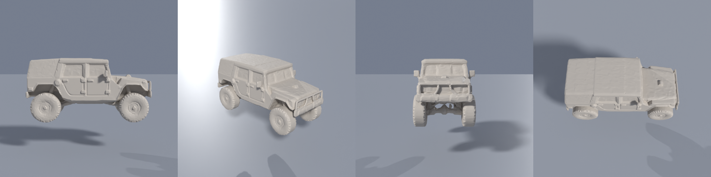
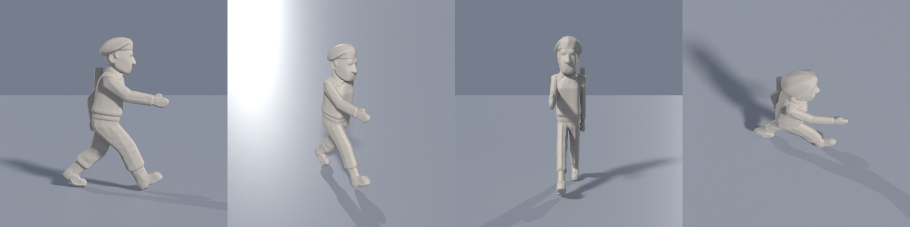
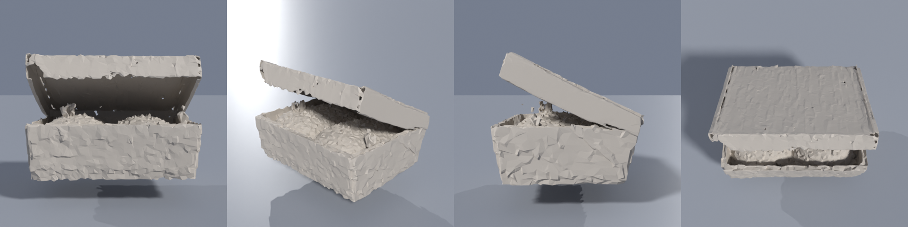
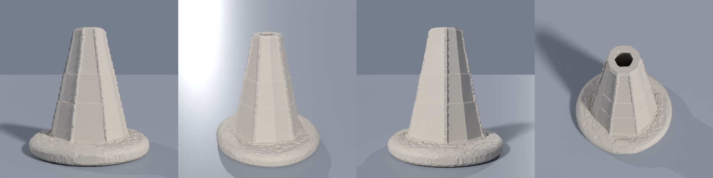
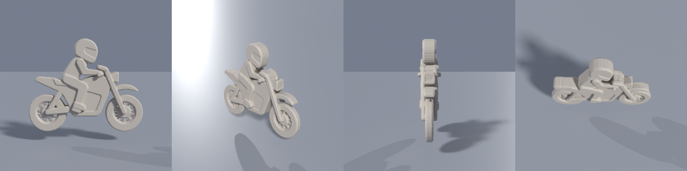
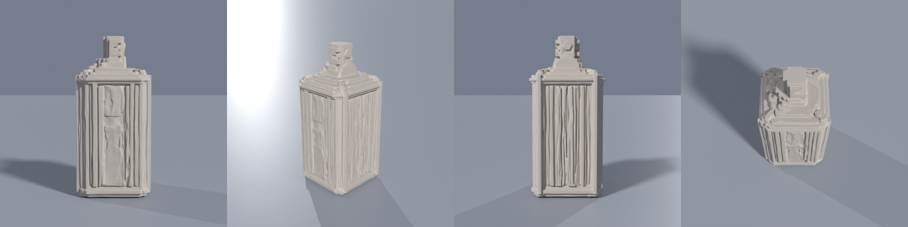

# Image to 3D on a free Google Colab GPU

Turn a single picture into a 3D mesh (`.glb`) with [Hunyuan3D-2mini](https://github.com/Tencent-Hunyuan/Hunyuan3D-2) on Colab's free T4. No local GPU and no API key.

## Quick start

1. Open the notebook with the badge above and set **Runtime → Change runtime type → T4 GPU**.
2. Run cells 1 and 2. Colab will say the session crashed after cell 2. That is the intended restart.
3. Run cells 3 to 5. Upload a picture (or press cancel to use the demo picture) and download `model.glb`.

Open the `.glb` in Blender, Godot, three.js, or any glTF viewer.

## What came out

Six sprites from [Islamabad Runner](https://github.com/oyekamal/islamabad-runner), a pixel-art endless-runner game, run through the model. The sprites had a fake checkerboard painted into opaque pixels, so [`tools/prep_inputs.py`](tools/prep_inputs.py) cut them out first. Each sheet shows the same model from front, three-quarter, side and top.

| Sprite | Result | Render |
|---|---|---|
| Army jeep | **Good.** Reads as a real vehicle: wheels, doors, grille, roof. The sprite shows only the side, so the front and top are the model's guess. |  |
| Ranger | **Good.** A proper 3D figure with beret, boots and pack. The face and front are invented from a side view. |  |
| Biryani box | **Decent.** Open lid and rice are there. The surface is crumpled. |  |
| Police cone | **OK.** Right silhouette. Lumpy base, faceted sides. |  |
| Biker | **Weak.** A thick cut-out, not a bike. One flat side-view gives the model no depth. |  |
| Tear-gas can | **Weakest.** Boxy instead of round, with a noisy surface. |  |

The meshes are in [`examples/glb/`](examples/glb). They are grey clay, not painted: this model makes shape only.

**What to expect.** Objects drawn at a three-quarter angle, and vehicles and people with some visible depth, work best. Flat side-on cartoons with thin parts, and plain flat shapes, work worst.

## Numbers

Measured on a free Colab T4 (Python 3.13, torch 2.11 + CUDA 13):

- Peak GPU memory: **4.6 GB**
- About **100 seconds** per object at octree resolution 320, 5 steps (measured on the last object of the batch; I did not log the others)
- Raw mesh is about 560,000 faces; the notebook simplifies it to **30,000 faces** (0.5 MB per `.glb`)

## Why this model

| Model | GPU memory it needs | Fits a free T4? |
|---|---|---|
| Hunyuan3D-2mini (shape) | ~5 GB (4.6 GB measured) | yes, this repo |
| Hunyuan3D-2 with texture | ~16 GB per the README | borderline; needs compiled CUDA extensions, not tried here |
| Hunyuan3D-2.1 | 29 GB (shape + texture) | no |
| TRELLIS.2 | 24 GB or more, tested on A100/H100 only | no |

## Version pins that matter

Colab's current image breaks a plain `pip install`. The notebook handles this, but if you build your own cell, keep these:

- **`transformers<5`**: the Hunyuan3D checkpoint stores image-encoder weights under transformers 4 layer names (`attention.attention.query`, `mlp.weights_in`). Transformers 5 renamed them, so loading fails with hundreds of missing keys.
- **`diffusers<0.36`**: newer diffusers needs a `huggingface-hub` that transformers 4 cannot use.
- **`pymeshlab`**: `hy3dgen` imports it at startup even for shape-only use.
- **`hy3dgen --no-deps`**: keeps Colab's own torch instead of replacing it.
- **Restart after installing**: otherwise numpy and scipy fail with `_blas_supports_fpe`.

## Model storage (Google Drive)

The notebook uses a small helper, `get_model()`, instead of a plain download:

1. It mounts Google Drive (Colab asks you to allow it) and keeps models in `MyDrive/colab-models/hunyuan3d-2mini`.
2. If a **complete** copy is already there, it is used as it is, with no download. A copy counts as complete only when a marker file was written after a finished download.
3. If it is missing, the helper asks Hugging Face how big the download is and compares that with your free Drive space. If it fits, it downloads straight into Drive. If it does not fit, it uses the session's disk and tells you.
4. An interrupted download is resumed, not restarted. Nothing is ever deleted.

At about 7.6 GB it **fits** in a free Google Drive (15 GB in total), so on the first run it is saved there and later sessions skip the download.

Say no to the Drive prompt, or set `USE_DRIVE = False` in the helper cell, to always use the session's disk.

**The Google Drive step is new and has not been run in Colab yet.** The model-download cell in this notebook was replaced by `get_model()` after the tested run described here. I tested that helper's logic on its own against a real Hugging Face repo with a stand-in Drive folder (five cases: downloads into Drive, reuses a finished copy without downloading, falls back to the local disk when Drive is too small, repairs an interrupted download, and the `USE_DRIVE = False` switch), and I checked that every notebook cell parses. I have not run the real Drive mount (it needs your click to allow access), nor the edited notebook end to end. If something fails, please open an issue with the error text.

## Making a viewer page

[`examples/build_viewer.py`](examples/build_viewer.py) bakes the six models into one self-contained HTML page with a rotatable three.js viewer, a wireframe toggle, and the four-angle render for each. [`tools/render_glb.py`](tools/render_glb.py) makes the four-angle sheets in headless Blender.

## Running it from Claude Code (optional)

The `tools/` folder holds the scripts used to drive Colab from a terminal through the [mcp-colab-gpu](https://github.com/mio-github/mcp-colab-gpu) engine. They are rough tools, not a polished package. What they work around:

- That server's request for a Colab runtime has a **30 second timeout**. When Colab takes longer to provision a GPU, the request times out on your side but Colab still assigns the runtime. That runtime then blocks every later request with **HTTP 412** until it is released. [`tools/colab_sessions.py`](tools/colab_sessions.py) lists and releases leftover runtimes.
- A released runtime can still count against the one-session free limit for several minutes, so [`tools/colab_daemon.py`](tools/colab_daemon.py) keeps **one** runtime open, retries the assignment on 412, and runs code files you drop into a folder. Fixing a dependency error then takes seconds, not a new runtime each time. [`tools/make_job.py`](tools/make_job.py) builds a job that sends the input pictures and returns the `.glb` files through the kernel output, so Drive is not needed.
- The server also does not pin `mcp`, and `mcp` 2.x breaks it. Install with `uvx --with 'mcp<2' mcp-colab-gpu`.
- The login token expires after about an hour. Release runtimes with a fresh token, or the release call returns 401 and the runtime stays assigned.

## What was and was not tested

Tested on 2026-10-21: install, model load, and generation for all six objects on a free Colab T4, run through the scripts above. The `.glb` files and renders in this repo are the real output of that run.

Not tested: the notebook itself, end to end, as published (and the Google Drive step described above, which was added after that run). Its cells use the same commands that worked in the scripted run, but nobody has run the notebook in the Colab page yet. If a cell fails, please open an issue with the error. Also not tried: texture generation, other input sizes, and other seeds.

## Licences

- Notebook, scripts and README: MIT, see `LICENSE`.
- Models are **not** included. Hunyuan3D-2 weights fall under the [Tencent Hunyuan Community License](https://github.com/Tencent-Hunyuan/Hunyuan3D-2/blob/main/LICENSE), which excludes the EU, the UK and South Korea. Read it before using the output in a product.
- The example sprites and the meshes made from them come from the Islamabad Runner game and belong to its author.
